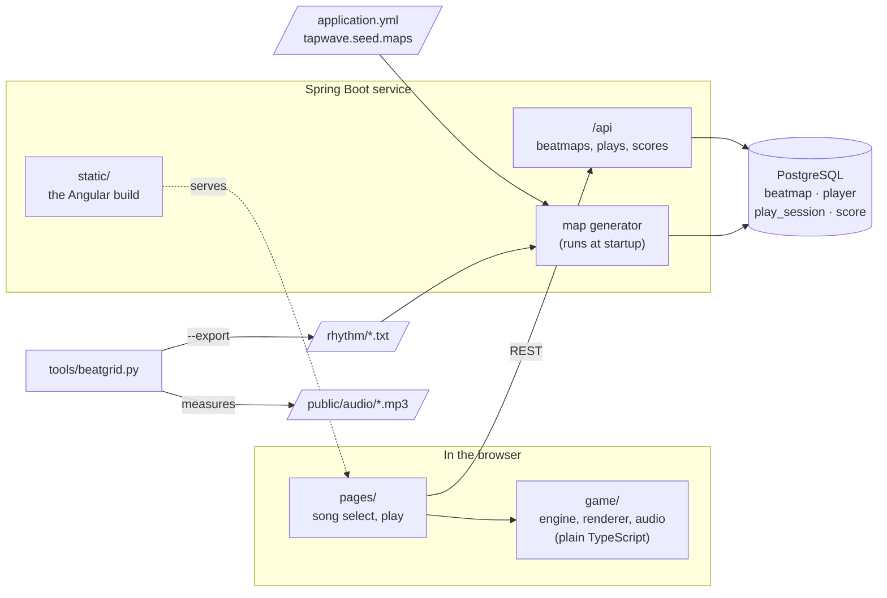
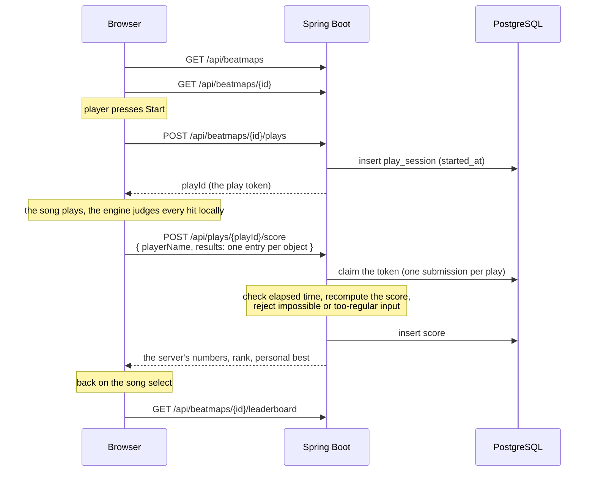

# 🏛️ Architecture

Tapwave is one Spring Boot service that serves both the Angular game and its REST API from one
origin, backed by PostgreSQL. The browser plays the song and judges every hit; the server never
trusts the client's score and recomputes it from per-object results.

This file is an index. Anything specific to one part lives in that part's own `README.md`.

## 🗺️ How it fits together

| Part                                    | What it is                                                                                         |
| :-------------------------------------- | :------------------------------------------------------------------------------------------------- |
| [`backend/`](./backend/README.md)       | Spring Boot app: REST API, score verification, map generation, Flyway schema                       |
| [`frontend/`](./frontend/README.md)     | Angular SPA; the game itself is framework-free TypeScript in `src/app/game/`                       |
| `shared/scoring-golden.json`            | Golden scoring cases both test suites run, see [rules implemented twice](#️-rules-implemented-twice) |
| `tools/beatgrid.py`                     | Measures a song's BPM, first downbeat and onsets, see [adding a song](./docs/adding-a-song.md)     |
| `Dockerfile`, `render.yaml`             | The production image and its Render Blueprint, see [deployment](./docs/deployment.md)              |
| `docker-compose.yml`                    | The local PostgreSQL 18 on port 5433                                                               |
| [`CREDITS.md`](./CREDITS.md)            | License and source of every song                                                                   |

## 🎯 The life of a play

The results screen shows the server's numbers, not the client's. Autoplay runs are never
submitted. The rejection rules are listed in the [README](./README.md#anti-cheat-and-its-limits).

## ⚖️ Rules implemented twice

The client needs the gameplay rules to judge hits and show a live score; the server needs them to
verify a play. They are written once in Java and once in TypeScript, and **a change to one side
without the other makes the server re-score or reject honest plays.**

| Rule                                                                                                  | Backend (`backend/src/main/java/dev/tapwave/`)                                                                                                           | Frontend (`frontend/src/app/`)                                                            |
| :---------------------------------------------------------------------------------------------------- | :------------------------------------------------------------------------------------------------------------------------------------------------------- | :---------------------------------------------------------------------------------------- |
| Circle size, approach time, hit windows, slider and spinner judgement, points per hit                 | `gameplay/Difficulty.java`                                                                                                                               | `game/rules.ts`                                                                           |
| Replaying a finished play: combo, HP, failure, accuracy, grade                                        | `gameplay/ScoreCalculator.java`                                                                                                                          | `game/score-keeper.ts` (`calculateScore`)                                                 |
| Judging live, in the same order: head before parts, a dropped tick or repeat breaks the combo, a missed tail does not, extra spins | `gameplay/ScoreCalculator.java`                                                                                              | `game/engine.ts` (`tryHit`, `updateSlider`, `missSliderHead`, `updateSpinner`)            |
| The API's shapes: maps, hit objects, per-object results, scores, leaderboard and recent scores        | `beatmap/HitObject.java`, `BeatmapSummary`, `BeatmapDetail`, `gameplay/ObjectResult.java`, `score/ScoreDtos.java`, the records in `score/LeaderboardQueries.java` | `core/models.ts`, written by hand                                                  |
| Player names: 1–24 letters, digits, spaces and `_ . -`                                                | `score/ScoreDtos.java`, `score/Player.java`, `V1__init.sql`                                                                                              | `PLAYER_NAME_PATTERN` in `core/settings.service.ts`, `maxlength` in `song-select.html`   |
| Synth tracks break down every 16th bar; their maps rest there (or spin, at level 3–4) only while the spec has no `breaks` | `BREAK_EVERY_BARS` in `beatmap/generator/BeatmapGenerator.java`                                                                   | `bar % 16` in `game/audio.ts`, which ignores `breaks`                                     |

One difference is intended: the client's `calculateScore` counts a hit outside every window as a
miss, while the server rejects the whole play. The live engine never records such a hit.

To change a scoring rule:

1. Change every place in its row, the live engine included.
2. Add or update a case in `shared/scoring-golden.json`. `ScoreCalculatorGoldenTest` and
   `score-keeper.spec.ts` both run every case, so the two implementations must agree on every number.
3. Run both test suites. `engine.spec.ts` also drives the real game engine with scripted sloppy
   players and checks that the live HUD score equals the recomputed one. Then play a map in dev mode,
   which warns in the console when the scores differ (see the [frontend README](./frontend/README.md#-the-game-engine)).
4. Mind what is already stored. Old scores are never re-scored, and each map's `max_combo` and
   `star_rating` were computed when it was generated, so a change to what adds combo leaves them
   wrong; see the [backend README](./backend/README.md#️-maps).
5. Mind open tabs. A deploy reaches a player only when the page reloads; until then their browser
   judges with the old rules, so a narrower hit window gets their honest plays rejected.

## ⚙️ Tech stack

Exact versions are in `backend/pom.xml` and `frontend/package.json`.

### 🖥️ Front-end

- [Angular](https://angular.dev): standalone components, zoneless, signals, `httpResource`
- [Canvas 2D](https://developer.mozilla.org/en-US/docs/Web/API/Canvas_API) for the playfield and HUD
- [Web Audio](https://developer.mozilla.org/en-US/docs/Web/API/Web_Audio_API) for the song clock,
  the synthesised tracks and hit sounds

### 🗄️ Back-end

- [Spring Boot](https://spring.io/projects/spring-boot) on Java 21: Web MVC, Data JPA, Validation,
  Actuator, and `JdbcClient` for the leaderboard SQL
- [PostgreSQL](https://www.postgresql.org) 18 with [Flyway](https://documentation.red-gate.com/flyway)
  migrations; hit objects are stored as JSONB

### 🛠️ Development tools

- Maven wrapper (`backend/mvnw`), npm, [Prettier](https://prettier.io) for the frontend
- Python 3 with [numpy](https://numpy.org) for `tools/beatgrid.py`

### 🧪 Testing

[`docs/testing-strategy.md`](./docs/testing-strategy.md) has the layers and where each test lives.
The tools are [JUnit Jupiter](https://junit.org) with [AssertJ](https://assertj.github.io/doc/),
[Testcontainers](https://testcontainers.com) over [Docker](https://www.docker.com), and
[Vitest](https://vitest.dev) with jsdom.

## ☁️ Deployment

| What                         | Runs on                                              | Deployed by                       |
| :--------------------------- | :--------------------------------------------------- | :-------------------------------- |
| The service (game and API)   | [Render](https://render.com) free web service, Docker, Frankfurt | every push to `main`  |
| PostgreSQL                   | [Neon](https://neon.tech) free plan, Frankfurt        | Flyway, when the service starts   |

Both are free with no card on file. [`docs/deployment.md`](./docs/deployment.md) is the runbook:
the free-tier limits, how to check a deploy, and how to fix the usual failures.
